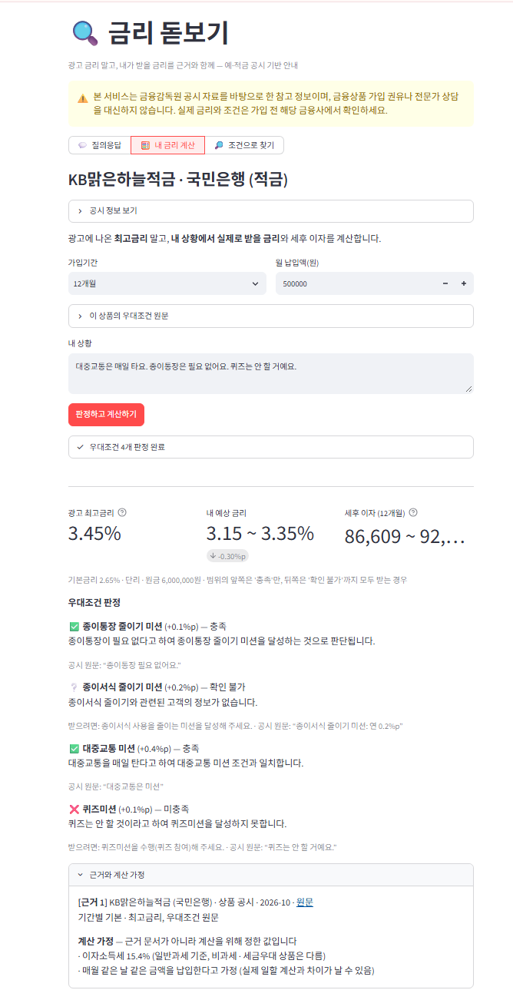
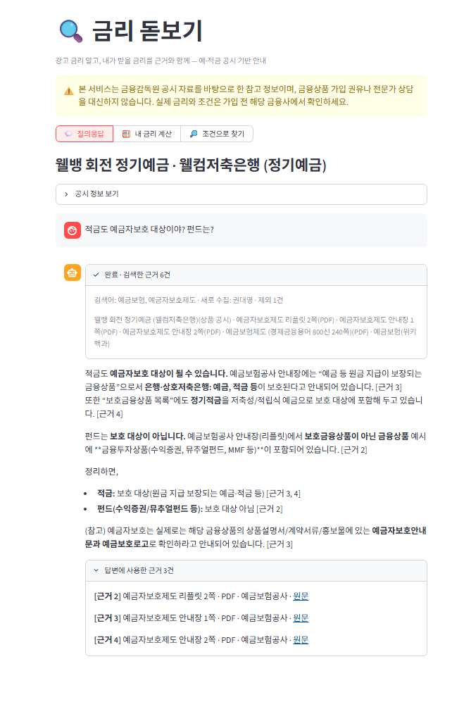
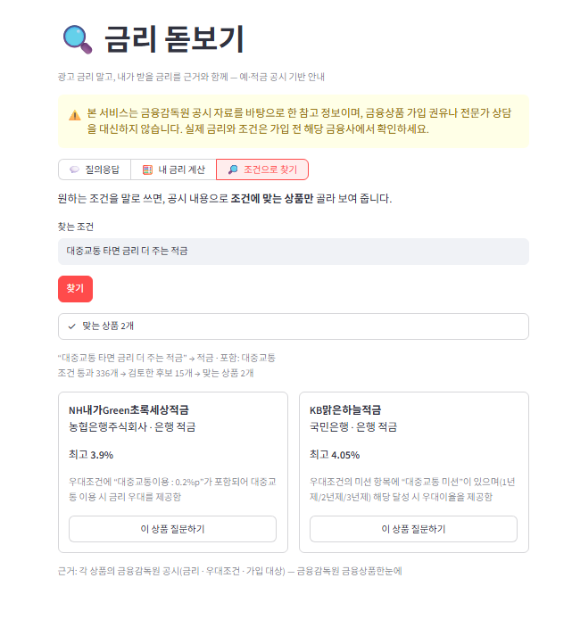
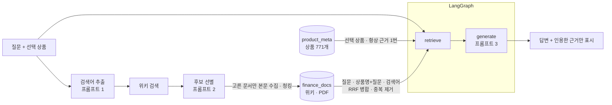

# 🔍 금리 돋보기 — 근거 기반 예·적금 RAG 서비스

> **광고 금리 말고, 내가 받을 금리를 근거와 함께.**

금융감독원 공시 예·적금 **771개**와 위키백과 · 공공기관 PDF에서 근거를 찾아 질문에 답하고,
답변이 실제로 인용한 근거만 출처와 함께 보여 주는 RAG 서비스입니다. *(SSAFY AI 코어 프로젝트 2회차)*


<p align="center">
  
  <br><sub>🧮 내 금리 계산 — 광고 최고 3.45%인 적금도, 내 상황에서는 3.15 ~ 3.35%</sub>
</p>

## 한눈에 보기

| | |
|---|---|
| **문제** | 적금 광고의 "최고 연 6%"는 급여이체 · 카드 실적 · 첫 거래 같은 우대조건을 **모두** 채워야 나오는 숫자다. 조건을 오해한 가입은 불완전판매의 단골 원인이고, LLM은 우대금리 수치를 그럴듯하게 틀린다 |
| **해결** | 모든 답에 공시 근거를 붙이고, 근거가 없으면 "확인되지 않습니다"라고 답한다. 판단은 LLM, 숫자 계산 · 검증은 코드가 맡는다 |
| **RAG 효과** | 같은 모델 · 같은 질문 6개 — RAG 없이 **정답 0개**(틀린 3개는 모두 단정하는 말투), RAG 사용 **정답 6개** · [비교](docs/rag_comparison.md) |
| **검증** | 요구사항 정의서 4장 자동 검증 **27 / 27 통과** · 화면 증명 15장 · [검증 결과](docs/verification.md) |
| **데이터** | 상품 771개 · 외부 문서 912청크(위키백과 + 예금보험공사 · 한국은행 PDF) · 우대조건 612줄 |

## 기능

### 💬 상품 질의응답 — 근거와 출처를 함께
상품을 고르고 질문하면, 필요한 위키 문서를 그 자리에서 찾아 모으고(검색어 추출 → 후보 선별 → 색인)
상품 공시 · 위키백과 · PDF를 근거로 답합니다. 답이 **실제로 인용한 근거만** 출처 종류와 원문 링크로 표시합니다.

<p align="center">
  
  <br><sub>"적금도 예금자보호 대상이야? 펀드는?" → 예금보험공사 안내장 · 리플릿(PDF)을 근거로 답변</sub>
</p>

### 🧮 내 금리 계산 — 도메인 특화 기능
내 상황을 말로 적으면 우대조건마다 **✅ 충족 · ❌ 미충족 · ❔ 확인 불가**를 판정하고, 예상 금리 범위와 세후 이자를 계산합니다.
- 판정은 LLM, 금리 합산 · 상한 · 단리/복리 이자 · 세금은 **코드** (LLM은 덧셈을 자주 틀린다)
- LLM이 읽어 온 우대금리 숫자와 인용 구절이 **공시 원문에 실제로 있는지 코드로 검사** — 없으면 계산 · 표시에서 뺀다
- 판단할 정보가 없으면 추측하지 않고 "확인 불가"로 두고 결과를 범위로 보여 준다

### 🔎 조건으로 찾기
"대중교통 타면 금리 더 주는 적금", "급여이체 없이 우대받는 1년 적금"처럼 말로 쓰면 **조건에 맞는 상품만** 카드로 보여 주고,
카드를 누르면 그 상품의 대화로 이어집니다.

<p align="center">
  
  <br><sub>336개 적금 → 후보 15개 → 조건을 모두 만족하는 2개</sub>
</p>

### 기능 목록

| 구분 | 기능 | 요구사항 |
|---|---|---|
| 필수 | 상품 메타데이터 적재 · 색인, 외부 문서 수집(검색어 추출 · 후보 선별) · 색인, 근거 검색 · 병합, 근거 기반 답변 · 근거 표시 | F2001 ~ F2008 |
| 필수 | 상품 선택 · 상품별 대화 / 내 금리 계산 / 조건으로 찾기 / 진행 상태 · 오류 · 면책 안내 | F2009 ~ F2012 |
| 심화 | **MMR 검색** — `SEARCH_TYPE=mmr`, 유사도 검색과 비교 · [결과](docs/mmr_comparison.md) | F2014 |
| 심화 | **RAG 전후 품질 비교** — 대표 질문 6개 · [결과](docs/rag_comparison.md) | F2015 |
| 심화 | **여러 문서 출처 결합** — 위키백과 + PDF, 출처 종류를 근거에 구분 표시 | F2016 |

## 동작 방식



## 핵심 설계 — 실험으로 정한 것들

| 결정 | 이유 (측정값) |
|---|---|
| **우대조건은 줄 단위로 따로 색인** | 상품 전체 텍스트로는 "대중교통 우대" 상품이 771개 중 **390위** — 공통 서식에 끌려간다. 한 줄 = 청크 하나로 나누자 **6위** |
| **여러 검색어 + RRF 병합** | 상품명을 붙이면 "이 은행 언제 생겼어?"는 풀리지만 "복리가 뭐야?"의 복리 문서가 밀려났다. 거리 대신 **순위로 합치는 RRF**로 둘 다 해결 |
| **본문을 받기 전에 후보 선별** | "중도해지" 위키 검색 후보 5개 중 4개가 중도우파 · 석가모니 — 제목 · 요약만 보고 걸러 헛된 호출을 줄인다 |
| **출처 종류별 청킹** | 용어사전은 용어 항목 단위(1,000자로 자르면 무관한 용어가 섞인다), 리플릿은 쪽 단위(2단 표의 머리말이 떨어지면 "펀드"가 보호 상품처럼 읽혀 **오답**) |
| **MMR은 선택 옵션** | MMR은 근거 간 평균 유사도를 4개 질문 모두 낮췄지만 무관한 문서도 끌어왔다. 금융 답변은 관련도를 우선 |
| **규칙은 코드, 의미 판단만 LLM** | 숫자 · 인용 검증, 외국 제도 문서 제외, 출력 표현 교정을 코드로 — 프롬프트 규칙만으로는 반복해서 새어 나왔다 |

겪은 문제 22가지와 해결 과정은 [설계 노트](docs/design_notes.md)에 실험 수치와 함께 남겨 두었습니다.

## 실행 방법

Python 3.10 이상. 모든 명령은 `project/` 폴더에서 실행합니다.

```bash
python -m venv .venv
source .venv/Scripts/activate          # Windows Git Bash · macOS/Linux 는 .venv/bin/activate
pip install -r requirements.txt
cp .env.example .env                   # GMS_KEY · WIKI_CONTACT (· FINLIFE_KEY) 입력
```

### 데이터 준비와 색인 (처음 한 번)

| 순서 | 명령 | 하는 일 | 소요 |
|---|---|---|---|
| 1 | `python scripts/fetch_products.py` | 금감원 API → `data/products.json` (저장소에 포함, 다시 받을 때만. `FINLIFE_KEY` 필요) | 10초 |
| 2 | `python scripts/build_meta_index.py` | 상품 771개 → `product_meta` (상품 1개 = 청크 1개) | 1분 |
| 3 | `python scripts/build_docs_index.py` | 위키 공통 개념 18건 · 금융사 29건 → `finance_docs` | 3분(처음) |
| 4 | PDF 3개를 `data/pdf/` 에 내려받기 | 아래 [데이터 출처](#데이터-출처와-이용-조건) 표의 링크 | — |
| 5 | `python scripts/build_pdf_index.py` | 안내장 · 리플릿(쪽 단위) · 용어사전(용어 단위 700개) → `finance_docs` | 1분 |
| 6 | `python scripts/build_condition_index.py` | 우대조건 한 줄 = 청크 하나 → `product_conditions` (조건 탐색용) | 30초 |

```bash
streamlit run app.py
```

> `project/` 폴더에서 실행해야 `.streamlit/config.toml`(화면에 오류 추적 정보 숨김)이 적용됩니다.
> `.env` 를 바꾼 뒤에는 앱을 다시 실행해야 반영됩니다.

### 확인 · 실험 스크립트

| 명령 | 용도 |
|---|---|
| `python scripts/check_env.py` | 키 · LLM · 임베딩 · 데이터 경로 점검 |
| `python scripts/ask.py "KB맑은하늘적금" "우대조건 뭐야?"` | 터미널에서 수집 → 근거 → 답 확인 |
| `python scripts/ask.py --graph` | LangGraph 구조 출력 (`docs/rag_graph.md`) |
| `python scripts/verify.py` | 요구사항 정의서 4장 자동 검증 (`docs/verification_results.md`) |
| `python scripts/compare_search.py` · `compare_rag.py` | MMR 비교 · RAG 전후 비교 |

설정은 모두 [config.py](config.py)에 있고, 실험 값은 환경변수로 덮어쓸 수 있습니다.
예) `CHUNK_SIZE=500 python scripts/build_docs_index.py` · `DOCS_TOP_K=2 SEARCH_TYPE=mmr streamlit run app.py`

## 구조

```
app.py                      UI — 화면만 그린다 (Streamlit)
config.py                   경로 · 모델 · 청킹 · 검색 · 계산 가정
domain/products.py          [데이터 준비] 도메인에 묶인 코드 전부 — 금감원 수집, 색인 텍스트, 문서 출처 목록
collect/wiki.py             [수집] 위키백과 검색 · 본문 (User-Agent · 재시도 · 간격 · 캐시)
collect/pdf.py              [수집] PDF → 문서 (출처 종류별 분할)
collect/pipeline.py         [수집] 질문 시점 수집 — 프롬프트 1 검색어 추출 · 프롬프트 2 후보 선별
store/vectordb.py           [색인] Chroma 컬렉션 · 청킹 · batch upsert
rag/graph.py                [검색 · 생성] LangGraph retrieve → generate, 다중 검색어 RRF 병합 · MMR
rag/prompts.py              프롬프트 (검색어 추출 · 후보 선별 · 답변 생성 · 우대조건 판정 · 조건 탐색)
services/rate_check.py      [서비스] 내 금리 계산
services/product_search.py  [서비스] 조건 기반 상품 탐색
scripts/                    수집 · 색인 · 확인 · 실험 · 검증
docs/                       설계 · 비교 · 검증 문서, 화면 캡처
```

## 데이터 출처와 이용 조건

| 데이터 | 출처 | 이용 조건 | 저장소 포함 |
|---|---|---|---|
| 예금 · 적금 상품 771개 (공시 2026-10) | [금융감독원 금융상품한눈에 Open API](https://finlife.fss.or.kr) | 공공 공시 자료, 출처 표시 | ✅ `data/products.json` |
| 위키백과 문서 (개념 18 · 금융사 29 · 질문 시점 수집) | [한국어 위키백과](https://ko.wikipedia.org) | CC BY-SA 4.0 — 근거마다 문서 제목과 원문 링크 표시 | ❌ (실행 시 수집) |
| 예금자보호제도 안내장 · 리플릿 | [예금보험공사 발간자료](https://www.kdic.or.kr/voc/pamphlet/list) | Copyright KDIC — 근거로 인용, 원문 링크 표시 | ❌ 직접 내려받기 |
| 경제금융용어 800선 (2026) | [한국은행](https://www.bok.or.kr/portal/bbs/B0000249/view.do?nttId=10096081&menuNo=200765) | Copyright BOK — 근거로 인용, 원문 링크 표시 | ❌ 직접 내려받기 |

- 위키백과 API는 `WIKI_CONTACT`(연락처)를 User-Agent에 넣어 호출하고, 429 응답 시 기다렸다가 재시도합니다.
- 이자소득세 15.4%는 받은 문서에 근거가 없어 **계산 가정**으로 분리해 표시합니다 (`config.INTEREST_TAX_RATE`).
- 본 서비스는 공시 자료 기반 참고 정보이며 금융상품 가입 권유나 전문가 상담을 대신하지 않습니다.

## 문서

| 문서 | 내용 |
|---|---|
| [요구사항 정의서](docs/requirements.md) | 도메인 선택 근거, 기능 · 비기능 요구사항 표와 구현 위치 |
| [RAG 파이프라인 설계문서](docs/rag_pipeline_design.md) | 컬렉션 · 메타데이터, 수집 · 청킹 · 색인 흐름, 병합 · 중복 제거, 프롬프트, 설정값의 근거 |
| [설계 노트](docs/design_notes.md) | 단계별로 겪은 문제 22가지와 해결 과정 (실험 수치 포함) |
| [검증 결과](docs/verification.md) | 요구사항 대조표 · 테스트 결과표 · 자동 검증 · 화면 증명 15장 |
| [MMR 비교](docs/mmr_comparison.md) · [RAG 전후 비교](docs/rag_comparison.md) | 심화 F2014 · F2015 |
