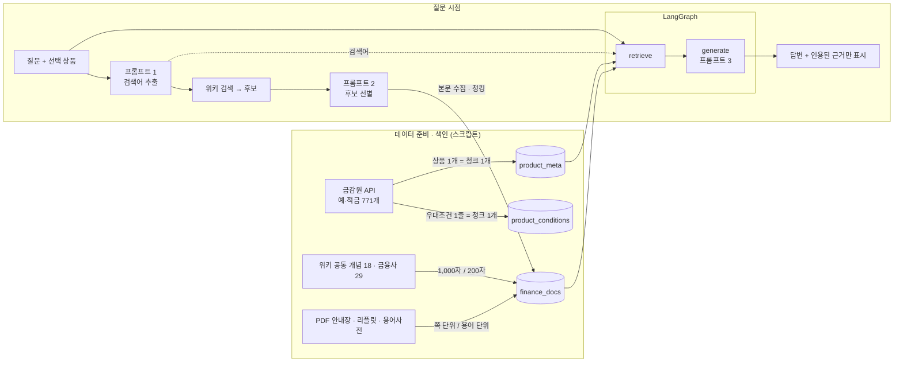

# RAG 파이프라인 설계문서 — 금리 돋보기

요구사항 정의서 6장 "RAG 파이프라인 설계문서" 항목 순서로 정리했다. 실험 수치와 시행착오의 자세한 기록은 [design_notes.md](design_notes.md).

## 0. 전체 흐름

## 1. Vector DB 컬렉션 구조와 메타데이터

Chroma · 임베딩 `text-embedding-3-small`(1536차원) · 코사인 거리.

| 컬렉션 | 내용 | 청크 단위 · id | 메타데이터 | 용도 |
|---|---|---|---|---|
| **product_meta** (RAG 1) | 예·적금 771개 | 상품 1개 = 1청크 · `유형:금융사코드:상품코드` | product_id · name · company · kind · group · best_base_rate · best_max_rate · has_special_condition · terms · join_deny · disclosed_month · source · url | 질의응답의 "항상 포함하는" 근거 1번 (id로 조회) |
| **finance_docs** (RAG 2) | 위키 · PDF 912청크 | 문서를 청킹 · `범위키:문서ID:순번` | doc_id · title · url · source_type · **scope**(common/company/product) · company · product_id · search_query · collected_at · scope_key · chunk_index | 질문 의미 검색 |
| product_conditions (보조) | 우대조건 612줄 | 우대조건 1줄 = 1청크 · `상품ID:cond:순번` | product_meta 와 같음 + line_index | 조건 탐색(F2011) 전용 |

**문서 범위(scope)를 둔 이유** — 영화는 "영화마다 관련 문서"가 있지만, 예·적금은 상품마다 위키 문서가 없다. 대부분은 모든 상품이 함께 쓰는 개념 문서다.

| scope | 예 | 검색 범위 |
|---|---|---|
| common | 예금보험, 복리, 용어사전 700항목, 예금자보호 리플릿 | 모든 상품 |
| company | KB국민은행, 웰컴저축은행 | 그 금융사 상품만 |
| product | 질문 시점에 수집한 문서 | 그 상품만 |

검색 필터 `$or: [scope=common, company=선택 금융사, product_id=선택 상품]` — 다른 금융사의 문서가 근거에 섞이지 않는다.
청크 id에 범위키를 넣어, 같은 위키 문서가 공통으로 한 번 · 특정 상품용으로 한 번 들어가도 서로 덮어쓰지 않는다.

## 2. 문서 수집 · 청킹 · 색인 흐름

**미리 색인 (스크립트)**
1. `fetch_products.py` — 금감원 API 4종(예금/적금 × 은행/저축은행)을 페이지별로 받고, 기간별 금리 행을 상품 단위로 묶는다.
2. `build_meta_index.py` — 상품마다 색인 텍스트 1개 + 메타데이터 → upsert.
3. `build_docs_index.py` — 공통 개념 19개 제목(검색 결과를 눈으로 확인해 고정) · 금융사 문서(정확한 제목으로만 조회) → 청킹 → 색인.
   넘겨주기가 다른 주제로 가면 버린다 (예: "단리" → "청풍면 (제천시)").
4. `build_pdf_index.py` — PDF 텍스트 추출 → 출처 종류별 분할 → 색인 (§5).
5. `build_condition_index.py` — 우대조건을 줄 단위로 나눠 보조 색인.

**질문 시점 수집** (`collect_for_question`, 그래프 실행 전)
1. 항목 자체 문서: 그 금융사 위키 문서가 없으면 선별 없이 색인 (상품당 한 번).
2. 같은 상품 · 같은 질문이면 여기서 끝 (캐시).
3. 프롬프트 1 → 검색어 ≤ 3개. 이 상품에서 이미 수집한 검색어는 뺀다.
4. 검색어마다 위키 검색 5건 → 이미 색인된 문서는 후보에서 뺀다.
5. 프롬프트 2 가 제목 · 요약만 보고 고른다 → 고른 문서만 본문 수집 → scope=product 로 청킹 · 색인.

**재색인 안전성** — 문서마다 이전 청크를 먼저 지우고 넣는다. 청크 크기를 1,000 → 500 → 1,000 으로 바꿔도 135 → 268 → 135 (예전 조각이 남지 않음).
문서 여러 건은 모아서 batch 로 임베딩한다 (용어사전 700항목 16분 48초 → 59초).

## 3. 검색 결과 병합과 중복 제거

retrieve 노드:
1. **메타 청크** — 선택 상품의 청크를 id 로 꺼내 항상 근거 1번에 둔다 (검색하지 않음).
2. **여러 검색어로 외부 문서 검색** — 한 검색어로는 어느 한쪽 질문이 망가졌다.

   | 검색어 | 강한 질문 | 없을 때 실패 예 |
   |---|---|---|
   | 질문 원문 | 개념 질문 | — |
   | 금융사 + 상품명 + 질문 | "이 은행", "여기" | "이 은행은 언제 생겼어?" → 네오뱅크 문서만 |
   | 프롬프트 1 검색어 | 주제가 둘 섞인 질문 | "세금은? 중도해지는?" → 원천징수 문서 못 찾음 |
3. **거리 기준선** — 코사인 거리 0.65 초과는 버린다 (실험: 관련 0.43~0.58, 무관 0.59~0.78).
4. **중복 제거** — 키 `문서ID:순번`. 같은 위키 문서가 common · product 범위로 두 번 색인돼 있어도 하나로 합친다.
5. **RRF 병합** — 거리 값 대신 각 검색에서의 순위로 점수 `Σ 1/(60+순위)`. 거리로 합치면 상품명 검색의 금융사 문서(0.5대)가
   늘 이겨 "복리" 문서가 밀려났다. RRF 로 바꾸자 들어와 인용됐다.
6. 상위 Top-k(5)개. MMR 모드에서는 검색어마다 후보 30개 → λ=0.5 로 5개를 고른 뒤 같은 방식으로 병합.

## 4. 프롬프트 (rag/prompts.py)

| 프롬프트 | 역할 | 입력 | 출력 형식 | 설계 포인트 |
|---|---|---|---|---|
| 1 검색어 추출 | 금융 전문가 | 상품명 · 유형 · 질문 | JSON 문자열 배열 ≤ 3 | 공시만으로 답할 질문은 `[]` (예시 7개로 학습) → 불필요한 수집 · 노이즈 문서 차단 |
| 2 후보 선별 | 근거 검토자 | 질문 · 후보 번호 · 제목 · 요약 | JSON 정수 배열 ≤ 3 | **본문 받기 전에** 고른다 — "중도해지" 후보 5개 중 4개가 중도우파 · 석가모니. 동음이의어 · 타국 제도 · 느슨한 관련 제외, 빈 배열 허용 |
| 3 답변 생성 | 금융상품 안내 전문가 | 근거(번호 · 제목 · 출처 종류 · 본문) · 상품 · 질문 · 최근 대화 6개 | `[근거 N]` 붙은 답 | 근거만 사용, 없으면 "공시 자료와 수집된 문서에서 확인되지 않습니다", 실제 쓴 근거에만 번호, 가입 권유 · 평가 금지, 금리는 근거 그대로 |

특화 기능용 프롬프트: 우대조건 판정(JSON 객체 — 조건별 rate · verdict · reason · how_to · quote, cap), 조건 탐색 파싱(필터 + 포함/제외 핵심어), 조건 탐색 검증(후보별 판정 이유를 먼저 쓰고 마지막에 JSON — 이유를 먼저 쓰게 하자 부정 조건 판정이 정확해졌다).
LLM 출력은 `rag/parsing.py` 가 코드 블록 · 앞뒤 설명 · 설명 속 괄호(`[P1]`)가 있어도 JSON 을 찾아낸다.

## 5. 청크 크기 · 중복 길이 · Top-k

| 설정 | 값 | 이유 | 바꿨을 때 |
|---|---|---|---|
| 위키 청크 크기 / 중복 | 1,000자 / 200자 | 위키 문단 1~2개 분량. 중복은 문장이 경계에서 잘려도 앞뒤 맥락이 이어지게 | 500/100 → 청크 135 → 268. 조각이 짧아져 정답 문장 주변 맥락이 줄고 같은 문서 조각이 근거를 더 차지 |
| 상품 메타 | 상품 1개 = 1청크 (자르지 않음) | 상품 정보는 금리 · 우대조건이 함께 있어야 답할 수 있다 | — |
| 우대조건 보조 색인 | 1줄 = 1청크 | 상품 전체 텍스트는 공통 서식에 끌려 "대중교통" 상품이 390위 | 줄 단위 6위 · 2위 |
| PDF 용어사전 | 용어 항목 1개 = 1문서 | 고정 길이로 자르면 무관한 용어가 한 청크에 섞여 근거 제목과 내용이 어긋남 | 606개(최대 40,095자) → 정리 후 700개(최대 2,471자) |
| PDF 안내장 · 리플릿 | 쪽 1개 = 1청크 | 2단 표(보호/비보호)의 머리말이 표 맨 위에 한 번만 남아, 자르면 "뮤추얼펀드"가 보호 상품처럼 읽힘 | 1,000자로 자를 때 "펀드도 보호돼?" 오답 → 쪽 단위로 정답 |
| 외부 문서 Top-k | 5 (+ 메타 1) | 질문 하나에 필요한 개념 문서는 보통 2~3개. 여유를 두고, 무관한 문서는 거리 기준선과 "인용한 근거만 표시"로 거른다 | 2 → 외부 근거 2건(예금보험 · 웰컴저축은행), 5 → 5건 |
| 거리 기준선 | 0.65 | 측정한 관련/무관 경계 | 낮추면 근거가 0건이 되는 질문이 생기고, 높이면 무관한 문서가 늘어 토큰만 쓴다 |
| 검색 방식 | 유사도 (MMR 선택 가능) | MMR은 근거 간 평균 유사도를 4개 질문 모두 낮췄지만 무관한 문서(상호저축은행 등)도 끌어왔다. 이미 다중 검색어 RRF 로 다양성이 있어 금융 답변에는 관련도를 우선 | [mmr_comparison.md](mmr_comparison.md) |

모든 값은 `config.py` 에 있고 환경변수로 덮어쓸 수 있다 (`CHUNK_SIZE`, `CHUNK_OVERLAP`, `DOCS_TOP_K`, `DOCS_MAX_DISTANCE`, `SEARCH_TYPE`, `MMR_LAMBDA`).

## 6. 근거 표시 방식

1. retrieve 가 근거에 1부터 번호를 매기고, 프롬프트 3 이 같은 번호로 `[근거 N]`을 붙인다.
2. 화면은 답변 본문에서 `[근거 N]`, `[근거 1, 3]`을 정규식으로 찾아 **실제 인용한 근거만** 표시한다 — 검색했지만 안 쓴 근거는 보이지 않는다.
3. 같은 문서의 여러 조각은 한 줄로 묶는다 — `[근거 3, 4] 예금보험공사 · 위키백과 · 원문`.
4. 출처 종류를 구분한다 — `상품 공시 · 2026-10` / `위키백과` / `PDF · 예금보험공사` / `PDF · 한국은행`. PDF 는 제목에 쪽 번호.
5. 인용이 0건이면 "ⓘ 답변에 인용된 근거가 없습니다".
6. 프롬프트에 "번호는 내용을 실제로 썼을 때만"을 넣었다 — "[근거 1]은 날씨와 무관합니다"처럼 언급만 해도 인용으로 잡혔기 때문.
7. 대화를 다시 그릴 때도 메시지에 저장한 근거로 다시 표시한다.

## 7. 도메인 특화 기능 설계 이유 — 내 조건 기준 실제 금리 판정

- **문제**: 광고는 최고금리를 보여 주지만 우대조건을 다 채우는 고객은 드물다. KB맑은하늘적금 광고 3.45% → "대중교통 매일 · 종이통장 필요 없음 · 퀴즈 안 함"이면 3.15~3.35%.
- **왜 RAG 가 필요한가**: 우대조건은 상품마다 문장으로 적혀 있고 매달 바뀐다. 기억으로는 답할 수 없고(RAG 없이 급여이체 우대를 0.5%p로 단정, 정답 0.7%p), 원문을 근거로 붙여야 고객이 확인할 수 있다.
- **역할 분리**: 판정(언어 이해)은 LLM, 금리 합산 · 상한 · 단리/복리 이자 · 세금은 코드. LLM 은 덧셈과 이자 계산을 자주 틀린다.
  검산: 월 50만 원 · 12개월 · 3.15% 단리 → 세전 102,375원 × 0.846 = 86,609원 (화면 값과 일치).
- **근거 없는 숫자 차단**: LLM 이 읽어 온 우대금리가 원문에 실제로 있는지 코드로 확인. "금리쿠폰 적용"처럼 숫자가 없으면 계산에서 빼고 표시.
- **확인 불가를 정직하게**: 고객 상황에 정보가 없으면 추측하지 않고 "확인 불가"로 두고, 결과를 범위(충족만 ~ 확인 불가까지)로 보여 준다.
- **근거와 가정 분리**: 금리 · 우대조건은 상품 공시 근거, 이자소득세 15.4% · 매월 같은 금액 납입은 "계산 가정"으로 따로 표시.

## 8. 선택한 이유와 겪은 문제 (요약)

| # | 문제 | 해결 |
|---|---|---|
| 1 | 상품 전체 텍스트로는 우대조건 검색 실패 (390위) | 우대조건 줄 단위 보조 색인 (6위) |
| 2 | 임베딩이 "적금/예금", "3% 넘는"을 구분 못 함 | 숫자 · 범주는 메타데이터 필터 |
| 3 | 위키 검색 · 넘겨주기가 엉뚱한 문서로 (단리 → 청풍면) | 제목 고정 + 제목 검사 / 질문 시점은 프롬프트 2 |
| 4 | 위키에 한국 예·적금 실무 정보가 얇음 | PDF 출처 결합 (F2016) |
| 5~6 | 대상을 생략한 질문 / 상품명을 붙이면 개념 문서가 밀림 | 다중 검색어 + RRF |
| 7~8 | 무관한 근거 · 번호 언급만 해도 인용으로 표시 | 거리 기준선 · 인용 규칙 · 인용된 것만 표시 |
| 9~11 | 섞인 질문 · 같은 질문 재수집 · 공시 질문에도 수집 | 검색어 재사용 · 질문 캐시 · 예시(few-shot) |
| 12 | 판정 기준이 모호하면 LLM이 반대로 판정 | 방향 예시 추가 (남은 한계: "잘 모르겠어요"는 흔들림) |
| 13~15 | 조건 탐색: 긴 검색 문장 · 부정 조건 · 번호 밀림 | 핵심어 분리 · 제외어는 코드로 · 이유 먼저 쓰기 · P번호 + 상품명 교차 확인 |
| 16 | 오류 시 브라우저에 트레이스백 노출 | showErrorDetails=none |
| 17 | PDF 표 구조가 텍스트 추출에서 깨져 오답 | 안내장은 쪽 단위 청크 |
| 18 | 프롬프트 2가 "미국 예금보험공사"를 반복 선별 | 외국 제도 문서는 코드로 먼저 제외 — 규칙으로 정할 수 있는 건 코드, 의미 판단만 LLM |
| 19 | 판정의 "공시 원문"에 고객 입력 문장이 표시됨 (캡처로 발견) | 인용이 원문에 실제로 있는지 코드로 확인, 없으면 원문 줄로 교체 |
| 20 ~ 22 | 지표 잘림 · "제공해주신 근거" · 키 오류 원인 불명 | 표시 방식 수정 · 생성 후 표현 교정 · 오류 종류별 안내 |

## 9. 남은 한계

- LLM 판정 · 선별은 실행마다 조금씩 다르다 (퀴즈 미션 "잘 모르겠어요"는 미충족 / 확인 불가가 오간다).
- 새 문서 수집이 필요한 첫 질문은 최대 44초.
- 이자소득세 15.4%는 근거 문서가 없어 계산 가정이다 (소득세법 조문을 출처로 추가하면 근거로 올릴 수 있다).
- PDF 의 표는 텍스트 추출로 구조가 깨진다 — 표가 많은 문서는 표 전용 추출이 필요하다.
